# Passive OSINT Group Investigation — unikl.edu.my

**Scope:** Passive OSINT only — no active scanning, no brute-force, no login attempts.
Each member filled the record for their own role; the table is copied for every additional finding.

---

## Finding 1: WHOIS / DNS

| Field | Entry |
|---|---|
| Identity | Muhammad Irfan Izzaty bin Mansor — 52215226193 |
| Source / target | unikl.edu.my |
| Tool / method | `nslookup` (local DNS lookup) |
| Exact query | `nslookup unikl.edu.my` |
| Capture timestamp | 8 Nov 2026, 15:40 MYT. Current (live lookup). |
| Observation | Resolver used: `homerouter.cpe`. Non-authoritative answer — Name: `unikl.edu.my`, Address: `103.148.105.96` |
| Interpretation | Suggests the domain resolves to IP `103.148.105.96` at the time of the query. Not conclusive proof — the server/CDN could change IP at any time, and the answer came from an ordinary resolver, not directly from UniKL's own authoritative DNS server. |
| Corroboration | Consistent with the WHOIS record (Finding 4), which shows the same IP. |
| Confidence + rationale | Inferred — single resolver, non-authoritative answer, no direct confirmation from UniKL's authoritative DNS server. |
| Limitation | Single resolver only, non-authoritative answer, IP may change over time. |

**Supporting evidence:**

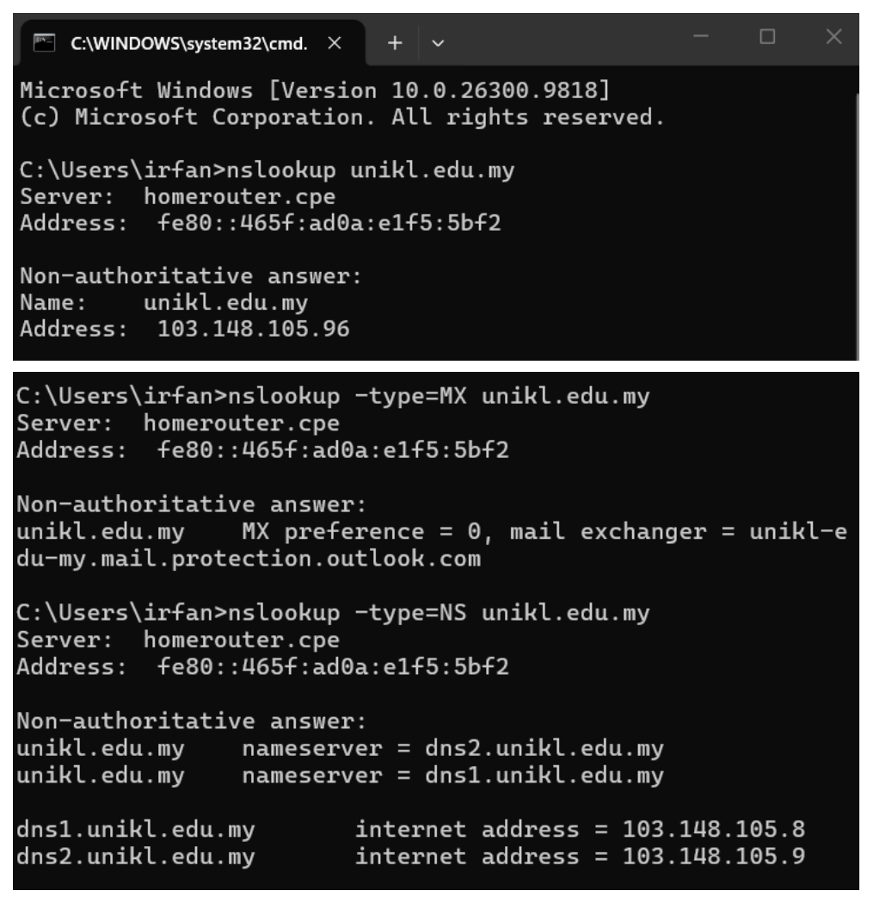

```
C:\Users\irfan>nslookup unikl.edu.my
Server:   homerouter.cpe
Address:  fe80::465f:ad0a:e1f5:5bf2

Non-authoritative answer:
Name:    unikl.edu.my
Address: 103.148.105.96

C:\Users\irfan>nslookup -type=MX unikl.edu.my
Non-authoritative answer:
unikl.edu.my   MX preference = 0, mail exchanger = unikl-edu-my.mail.protection.outlook.com

C:\Users\irfan>nslookup -type=NS unikl.edu.my
Non-authoritative answer:
unikl.edu.my    nameserver = dns2.unikl.edu.my
unikl.edu.my    nameserver = dns1.unikl.edu.my

dns1.unikl.edu.my   internet address = 103.148.105.8
dns2.unikl.edu.my   internet address = 103.148.105.9
```

---

## Finding 2: Subdomain OSINT

| Field | Entry |
|---|---|
| Identity | Muhammad Ammar Yaasir bin Shamsul Kamar — 52215227094 |
| Source / target | unikl.edu.my |
| Tool / method | Netcraft Search DNS (searchdns.netcraft.com). Reads Netcraft's existing indexed records; no request is sent to UniKL servers. |
| Exact query | Restriction "site contains", value `unikl.edu.my` |
| Capture timestamp | 7 Nov 2026, 17:31 MYT. Historical / indexed: "First seen" dates are Netcraft's observation dates, and the listing is not a live check. |
| Observation | 22 results were found, but only page 1 (20 of 22) was captured — 2 remaining results were not viewed. Among those found: `vle.unikl.edu.my` (April 2016), `cas.unikl.edu.my` (Nov 2012, org: Universiti Teknikal Mara Sdn Bhd), `portal.unikl.edu.my` (June 2013), `flex.unikl.edu.my` (hosted on Microsoft Corporation, first seen Jan 2024), `remotex.unikl.edu.my` (hosted on Amazon Technologies Inc., first seen April 2019), `eqvs.unikl.edu.my` (first seen September 2026 — very recent), `iums.unikl.edu.my` (no "first seen" date recorded), and `ir.unikl.edu.my` (Oct 2016) / `www.ir.unikl.edu.my` (Jul 2012) appear to be a related/duplicate-like pair of subdomains. Most other entries are hosted under "Run Up Game Distribution & Development Sdn Bhd" or "Universiti Teknikal Mara Sdn Bhd". |
| Interpretation | **Establishes** that Netcraft has indexed at least 22 hostnames under unikl.edu.my, mostly on Malaysian netblocks, plus one on Microsoft and one on Amazon. **Suggests** a mainly on-premise or locally hosted setup with a few cloud-hosted services (flex likely on Azure; remotex, probably remote access, on AWS). **Does not prove** that every hostname is still active, who actually operates each server, or which services run on them. |
| Corroboration | Shodan (Finding 3) also shows hosts `online1.unikl.edu.my` and `online6.unikl.edu.my` on the same 103.148.105.x IP range as several Netcraft entries here. |
| Confidence + rationale | Inferred. The hostnames are indexed, and several match Shodan and Google, but Netcraft is one index with historical dates, and the netblock owner labels conflict with Shodan. |
| Limitation | "First seen" dates are Netcraft's observation dates, not proof the subdomain is currently active — it may well be decommissioned. Only 20/22 results viewed. |

**Supporting evidence:**

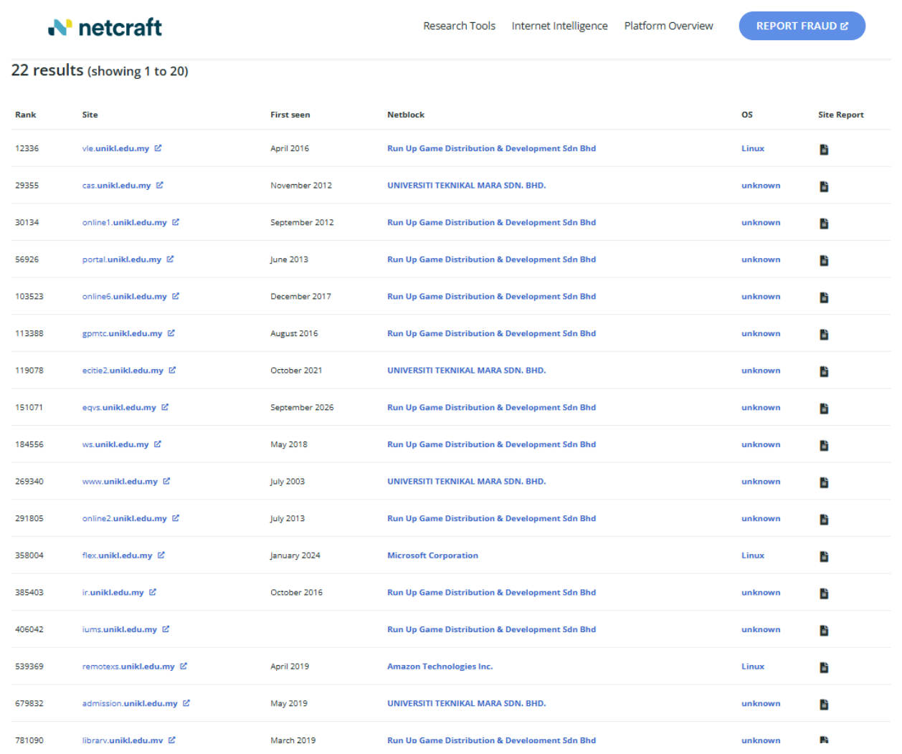

---

## Finding 3: Shodan Indexed Results

| Field | Entry |
|---|---|
| Identity | Muhammad Aiman Asnawi bin Azman — 52215226183 |
| Source / target | unikl.edu.my |
| Tool / method | Shodan web search (shodan.io), not logged in. Reads Shodan's stored crawl data. No scan on demand and no request from the student to UniKL. |
| Exact query | `unikl.edu.my` (plain keyword search, no hostname: filter) |
| Capture timestamp | 7 Nov 2026, 17:34 MYT. Historical / indexed. Shodan's own crawl dates on page 1 run from 2026-10-20 to 2026-11-07 (UTC): oldest dns1 (20 Oct), newest 103.148.105.16 (7 Nov, 00:54 UTC). |
| Observation | 17 indexed results (page 1 only viewed). Top ports: 443 (14), 53 (2), 80 (1). Top organizations: "Universiti Teknikal Mara Sdn Bhd" (10), "Extreme Broadband" (7) — **two different organizations/ISPs**; for example `online2.unikl.edu.my` (113.23.135.58) is registered under Extreme Broadband, unlike most other hosts. Products detected: Apache Tomcat, ISC BIND, Apache httpd. OS: Linux 3.x, Red Hat Enterprise Linux 7. Example hosts: `talentinside.unikl.edu.my` (103.148.105.16), `mivb.unikl.edu.my` (103.148.105.77, shows security headers HSTS, X-Frame-Options, nosniff). CAS login path observed: `https://cas.unikl.edu.my/cas-web/login?service=...` (CAS authentication portal). `dns2.unikl.edu.my` (103.148.105.9) discloses its BIND version in the banner — this is "version disclosure", not evidence of a vulnerability. |
| Interpretation | **Suggests** HTTPS (port 443) is the dominant exposed service. The presence of 2 distinct ISPs (UniKL's own + Extreme Broadband) suggests at least part of the infrastructure uses an external/commercial ISP connection, not everything on one network. This data is Shodan's own stored snapshot, not a live scan performed by the student. |
| Corroboration | IP 103.148.105.8 and .9 match dns1/dns2 from Finding 2 & 3 [i.e. Findings 1 & 2 of the main report]. The TLS certificate for `*.unikl.edu.my` (TLSv1.2/1.3) that Shodan shows also matches Finding 7 (Wappalyzer, TLS 1.3). |
| Confidence + rationale | Inferred. The dns1/dns2 and hostname matches across three sources are strong, but every banner is Shodan's stored snapshot, up to 18 days old, and only page 1 of 17 was reviewed. |
| Limitation | Indexed data may be stale (services/banners may have changed since Shodan's last crawl). No live verification performed. Only 1 page viewed. |

**Supporting evidence:**

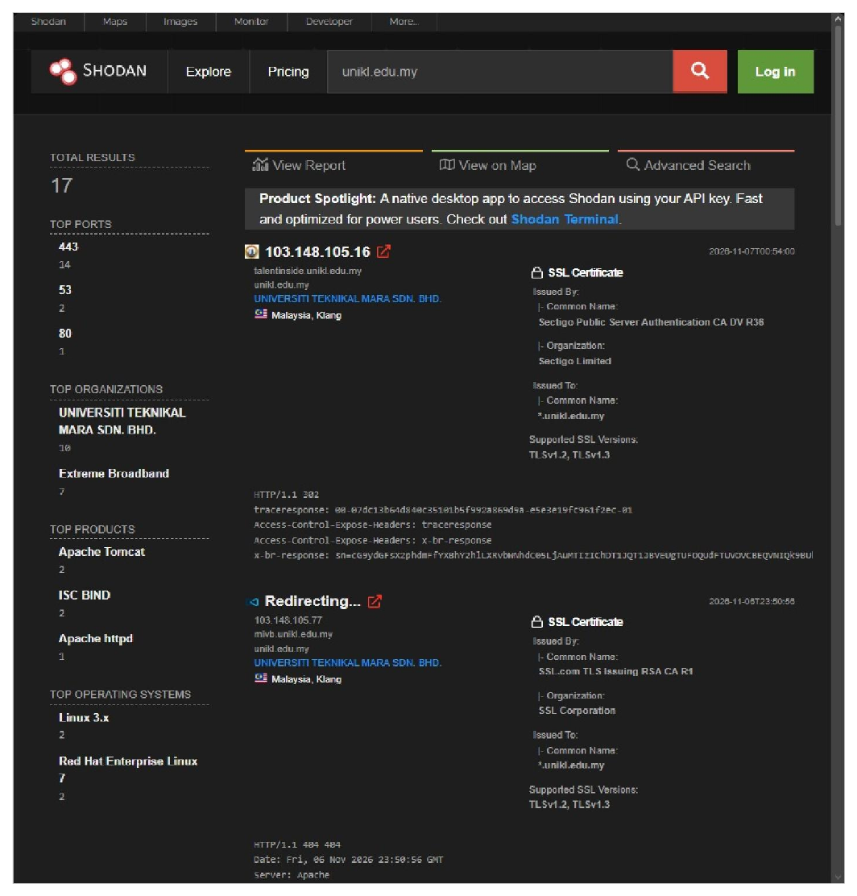
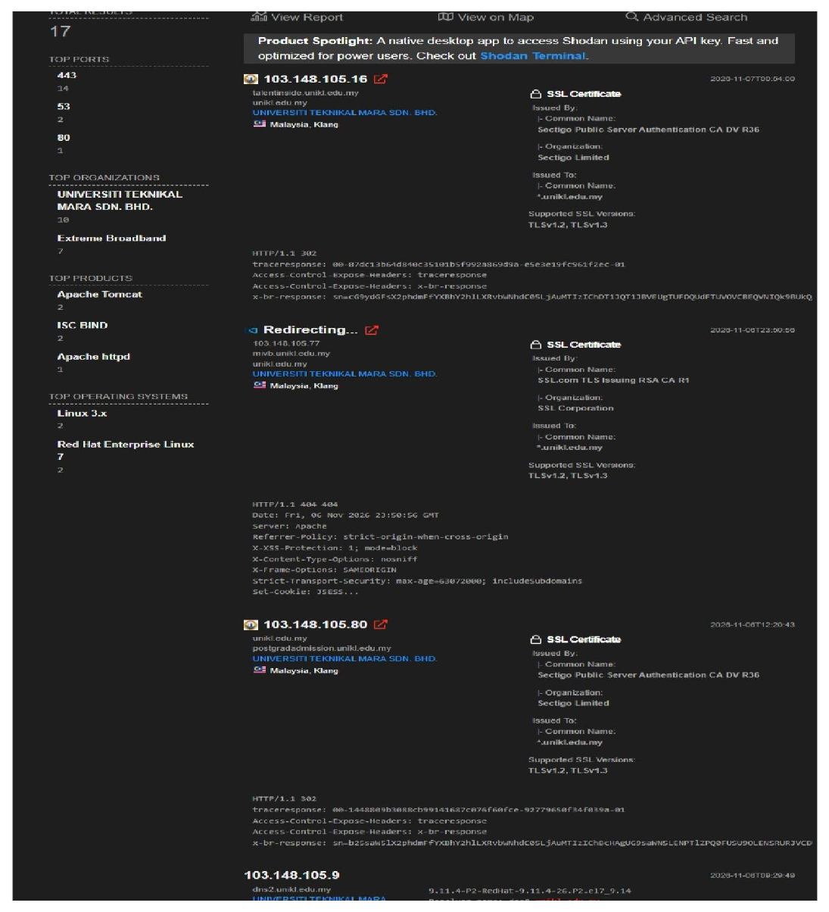
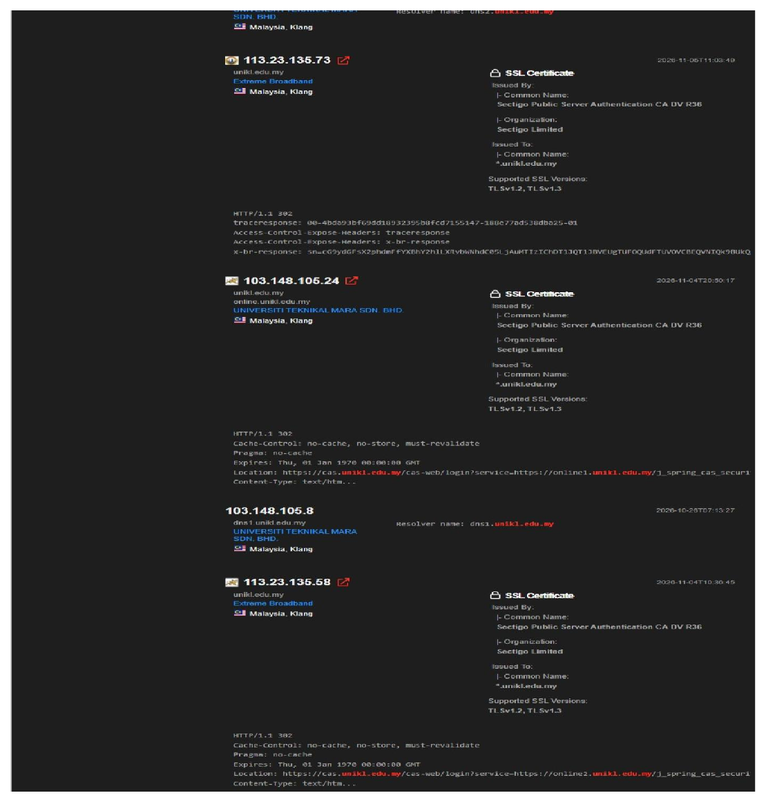
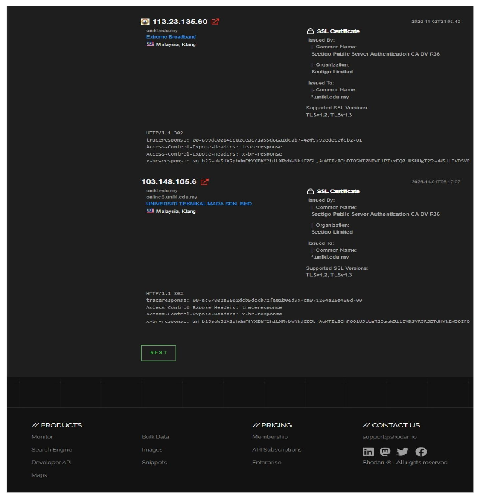

---

## Finding 4: Website Technology

| Field | Entry |
|---|---|
| Identity | Muhammad Azim Danial bin Nor Halim — 52215226066 |
| Source / target | unikl.edu.my |
| Tool / method | Wappalyzer (wappalyzer.com/lookup) — historical/passive technology lookup, not a live scan |
| Exact query | Lookup for "unikl.edu.my" on wappalyzer.com |
| Capture timestamp | 8 Nov 2026, 18:06 MYT — historical (Wappalyzer shows previously detected technology, not necessarily the current live status) |
| Observation | CMS: WordPress. Page builder: Elementor. Webmail: Microsoft 365. Email: Microsoft 365. Language: PHP. Database: MySQL. Framework: Bootstrap. Caching: WP Rocket. Live chat: Respond.io. Analytics: Google Analytics (GA4), Google Tag Manager. Certificate authority: Sectigo. Security: TLS 1.3 (certificate expires 21 Nov 2026), SPF record ✓, DMARC record ✓ |
| Interpretation | **Establishes**: the main website relies on the Microsoft ecosystem (365, possibly Azure). **Suggests**: UniKL relies heavily on the Microsoft ecosystem. **Does not prove**: the exact current configuration — Wappalyzer shows historical detection records, so the technology may have changed since. |
| Corroboration | TLS 1.3 certificate cross-confirmed with Shodan (Finding 3 above). SPF/DMARC confirmed directly via an independent DNS TXT lookup (`nslookup -type=TXT`) — not just Wappalyzer's estimate. |
| Confidence + rationale | Inferred — technology fingerprint based on external signals, not direct code/server inspection. (For SPF/DMARC specifically: Confirmed, since independently verified via a separate DNS TXT lookup.) |
| Limitation | Fingerprinting is based only on externally detectable signals; not a fully verified software inventory. The TLS certificate expires 21 Nov 2026 — this detail will age quickly. |

**Supporting evidence:**

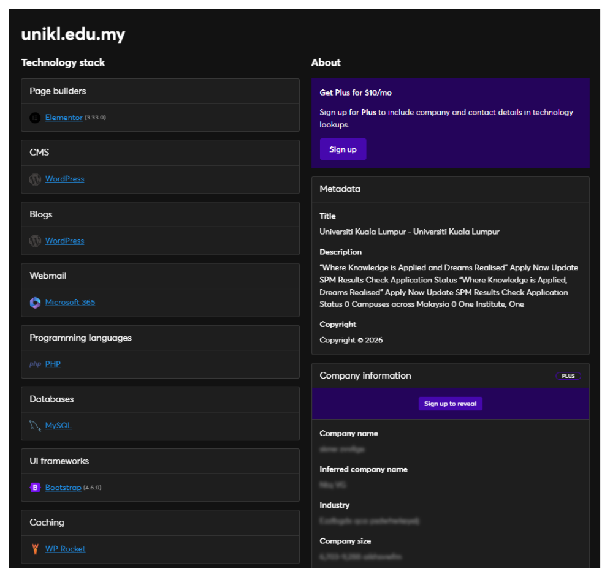
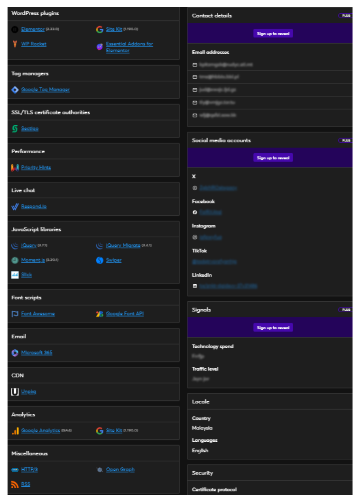

---

## Finding 5: Google Dorking

| Field | Entry |
|---|---|
| Identity | Muhammad Hayat bin Abdullah — 52215226009 |
| Source / target | unikl.edu.my |
| Tool / method | Google Search with site/filetype/intitle operators |
| Exact query | (1) `site:unikl.edu.my intitle:"handbook"` (2) `site:unikl.edu.my filetype:pdf` (3) `site:unikl.edu.my -site:www.unikl.edu.my` |
| Capture timestamp | 8 Nov 2026, 18:18 MYT — current (live Google index at time of search) |
| Observation | (1) Handbook search surfaced an "Open and Distance Learning Handbook for Postgraduate Students" on `flex.unikl.edu.my`, plus several Programme Handbook PDFs (24–73 pages) on `micet.unikl.edu.my`. (2) PDF search surfaced admin/guide documents on `online1.unikl.edu.my` (Student Email guide, fee refund policy, UGMS manual, postgraduate fees, research fee summary). (3) Excluding the main www subdomain surfaced an active news/press subdomain, `xpress.unikl.edu.my`, publishing dated articles (Oct 2026) about student competitions and events, plus `teknoputra.unikl.edu.my` (entrepreneurship unit) and `mestech.unikl.edu.my` (a technical institute site). |
| Interpretation | **Establishes**: UniKL runs several independently-branded subdomains beyond the main site (xpress, teknoputra, mestech, micet), each publishing its own public content. **Suggests**: a decentralised content-management pattern — individual faculties/units maintain and publish their own pages/documents rather than everything going through one central site. **Does not prove**: how these subdomains are hosted or administered internally — only that Google has indexed public content from them. |
| Corroboration | `micet.unikl.edu.my` and `flex.unikl.edu.my` overlap with subdomains already seen in Netcraft (Finding 2) and `online1.unikl.edu.my` already seen in the earlier PDF dork — repeat appearance across independent tools/queries. |
| Confidence + rationale | Confirmed — all results are directly viewable/clickable search results, not an inference. |
| Limitation | Google's index reflects crawl history, not necessarily current page content; some linked PDFs may since have been updated, moved, or removed. News article dates (Oct 2026) show the xpress subdomain is actively maintained, but publication activity on the other subdomains (micet, flex) isn't separately confirmed here. |

**Supporting evidence:**

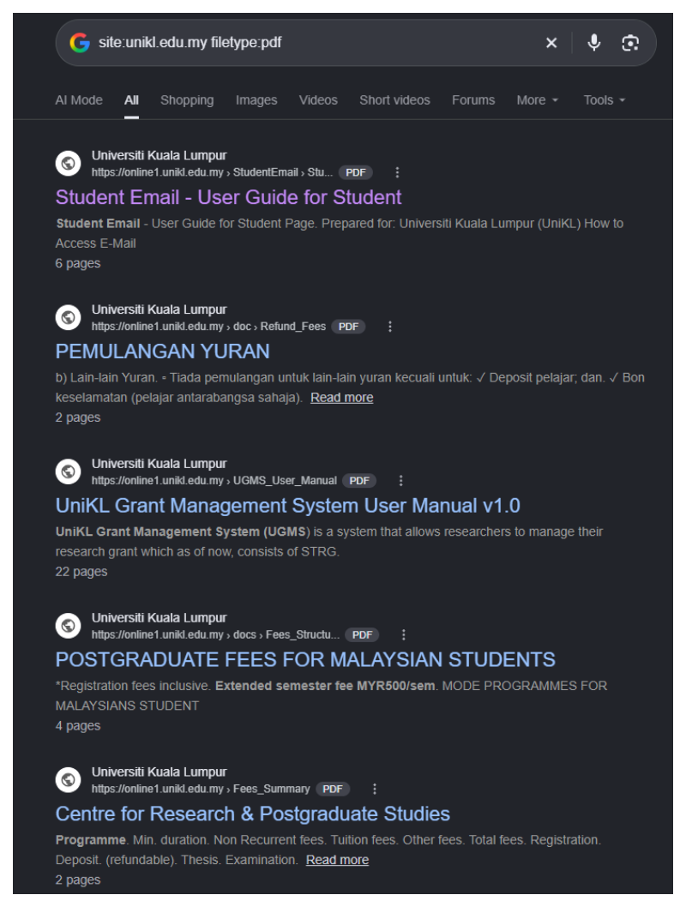

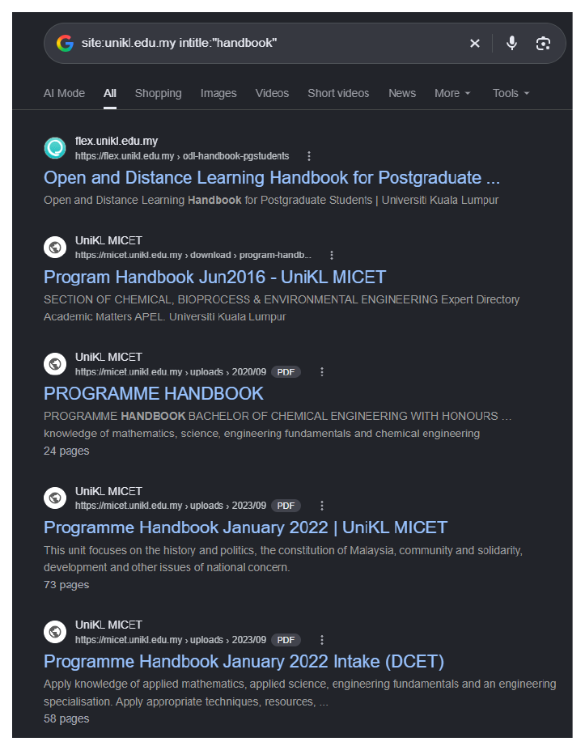

---

## Finding 6: Controlled Metadata / Files

| Field | Entry |
|---|---|
| Identity | Muhammad Zhofri Dinie bin Jafni — 52215226011 |
| Source / target | Controlled training sample |
| Tool / method | `file`, `xxd`, `exiftool` run on the lecturer's sample file |
| Exact query | `file rubiks.jpg solitaire.exe ocean.jpg dog.jpg computer.jpg` / `xxd rubiks.jpg \| head -3` / `xxd solitaire.exe \| head -3` / `exiftool rubiks.jpg solitaire.exe ocean.jpg` |
| Capture timestamp | 9 Nov 2026, 02:44 MYT — current (run live on Kali Linux) |
| Observation | `rubiks.jpg` and `solitaire.exe` were detected as **PNG image data** (not matching their extension). `ocean.jpg` was detected as JPEG with **comment: "THIS IS THE HIDDEN FLAG"** shown directly in the output. `xxd`: both `rubiks.jpg` and `solitaire.exe` begin with the bytes `89 50 4e 47` (official PNG magic bytes). `exiftool` confirmed File Type PNG for both, and Comment field = "THIS IS THE HIDDEN FLAG" for `ocean.jpg`. |
| Interpretation | **Establishes**: file extensions cannot be trusted — `rubiks.jpg` and `solitaire.exe` are actually PNG, not JPG/EXE. **Suggests**: these files were deliberately labelled by the lecturer to demonstrate "file type spoofing"/disguising. **Does not prove**: how these files were originally created or the actual intent behind them — only their technical content was verified. |
| Corroboration | Three independent methods (`file`, `xxd`, `exiftool`) each gave the same answer separately — strong triangulation, no external source needed. |
| Confidence + rationale | Confirmed — direct binary/hex/metadata inspection, not an assumption. |
| Limitation | `file` and `exiftool` only read the file header/first few bytes — they don't detect data appended after the file's end marker, or "polyglot" files (valid as two formats at once). Metadata dates (ModDate/CreateDate) reflect what the software wrote, not necessarily the true date. |

```
$ file rubiks.jpg solitaire.exe ocean.jpg dog.jpg computer.jpg
rubiks.jpg:    PNG image data, 609 x 640, 8-bit/color RGBA, non-interlaced
solitaire.exe: PNG image data, 640 x 449, 8-bit/color RGBA, non-interlaced
ocean.jpg:     JPEG image data, JFIF standard 1.01, ... comment: "THIS IS THE HIDDEN FLAG" ...
dog.jpg:       JPEG image data, JFIF standard 1.01, ...
computer.jpg:  JPEG image data, JFIF standard 1.01, ...

$ xxd rubiks.jpg | head -3
00000000: 8950 4e47 0d0a 1a0a 0000 000d 4948 4452  .PNG........IHDR
...
$ xxd solitaire.exe | head -3
00000000: 8950 4e47 0d0a 1a0a 0000 000d 4948 4452  .PNG........IHDR
...
```

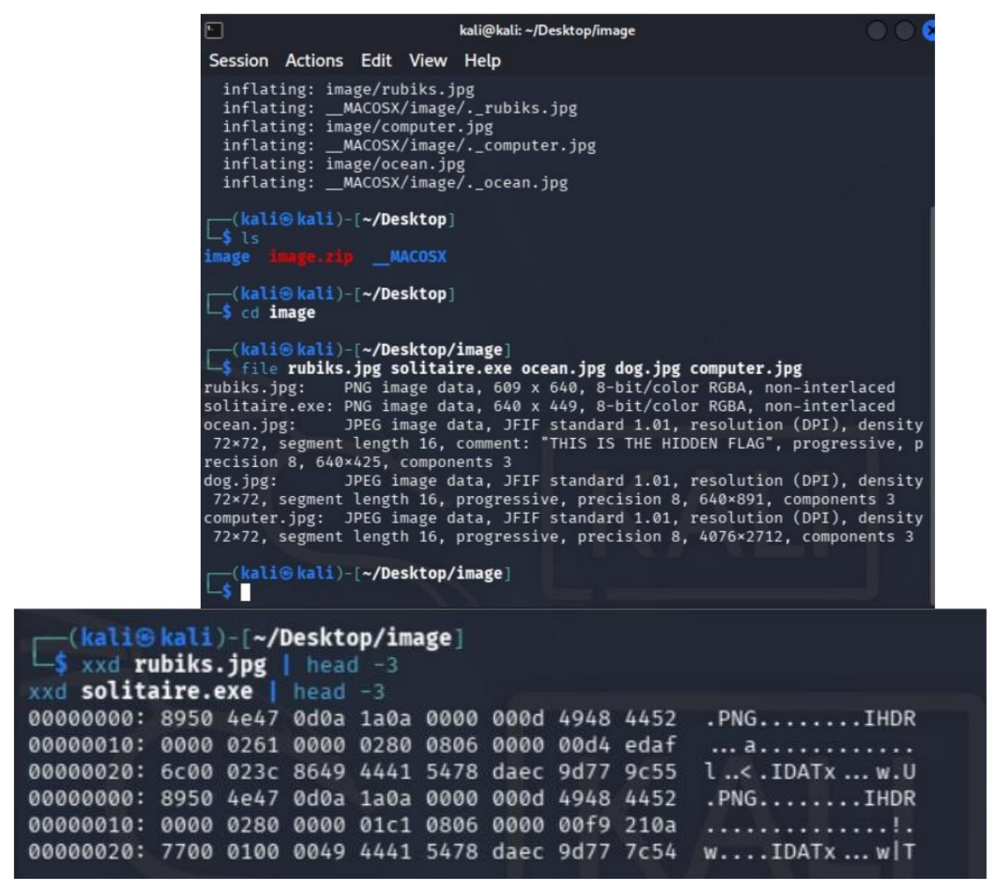
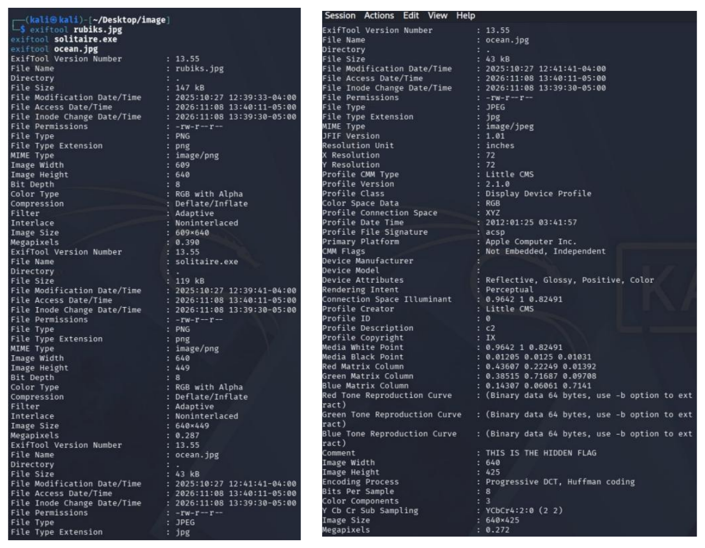

---

## Finding 7: Archives / Images / Public Text

| Field | Entry |
|---|---|
| Identity | Muhammad Haris bin Shamsul Kamal — 52215226144 |
| Source / target | unikl.edu.my |
| Tool / method | Internet Archive Wayback Machine (archive/index, no live contact with target). Pastebin concept covered via a negative-result Google search (see Finding 10 in the main report — reused here). Reverse-image search **not yet done** at this point (see gap below — completed separately, see "Reverse Image Search" below). |
| Exact query | `web.archive.org/web/*/unikl.edu.my` |
| Capture timestamp | 8 Nov 2026, 18:26 MYT — historical (the calendar itself shows archive data from 2003–2026) |
| Observation | Saved 5,703 times between 28 June 2003 (first capture) and 17 October 2026 (most recent capture). Capture frequency is very low 2003–2018 (sparse blue dots), then increases sharply from ~2019 onward, with near-daily captures through 2022–2026. A few green dots appear on the calendar, which the Wayback Machine itself labels as "redirects (3xx)" — meaning on those specific capture dates, the page returned a redirect rather than full content. |
| Interpretation | **Establishes**: the domain has existed and been publicly reachable since at least 2003, with archive coverage becoming much denser from 2019 onward. **Suggests**: the site's crawl/update activity (or at least Wayback's attention to it) increased substantially in the last ~5 years. **Does not prove**: how often the site's actual content changed — capture frequency reflects Wayback's crawl schedule, not UniKL's publishing activity. The redirect (green) dates don't by themselves tell us what URL the site redirected to without opening that specific snapshot. |
| Corroboration | Consistent with the WHOIS domain registration date (7 April 2003) from Finding 4 of the main report — two independent sources agree the domain is long-standing. |
| Confidence + rationale | Confirmed — the capture count and date range come directly from Wayback Machine's own display, not an estimate. |
| Limitation | Snapshot frequency is a measure of crawl activity, not site traffic or actual update frequency. No individual old snapshot was opened to compare its content against the current site — this step remains outstanding. |

**Supporting evidence:**

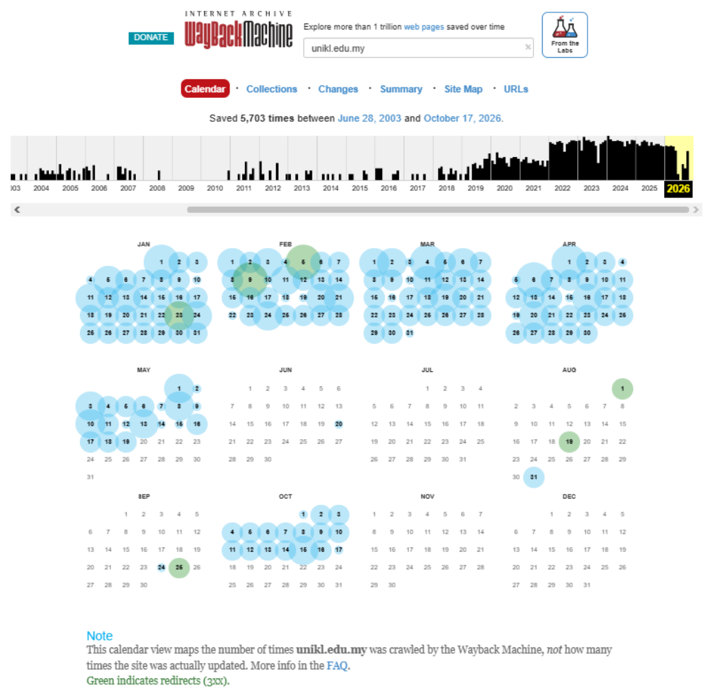

---

## Reverse Image Search

| Field | Entry |
|---|---|
| Identity | Muhammad Haris bin Shamsul Kamal — 52215226144 |
| Source / target | unikl.edu.my |
| Tool / method | Google Lens / Reverse Image Search |
| Exact query | Upload of the official UniKL logo (public, non-sensitive image) |
| Capture timestamp | 8 Nov 2026, 17:06 MYT |
| Observation | The UniKL logo appears across multiple public platforms: Seeklogo (vector/PNG download), Facebook (IPROM Media), Instagram ("The Meaning of UniKL Logo"), Software Wizards, and campus signage. |
| Interpretation | The logo is widely reused across public and social-media platforms. The same image appearing on many sites does **NOT** prove who published it first, nor the original location or time. Its presence on Seeklogo shows the logo is available as a public download asset. |
| Corroboration | The official unikl.edu.my website is the primary source of the logo. |
| Confidence + rationale | Inferred |
| Limitation | Reverse image search misses edited/cropped versions; no proof of origin or copyright; some results may use the logo without official permission. |

**Supporting evidence:**

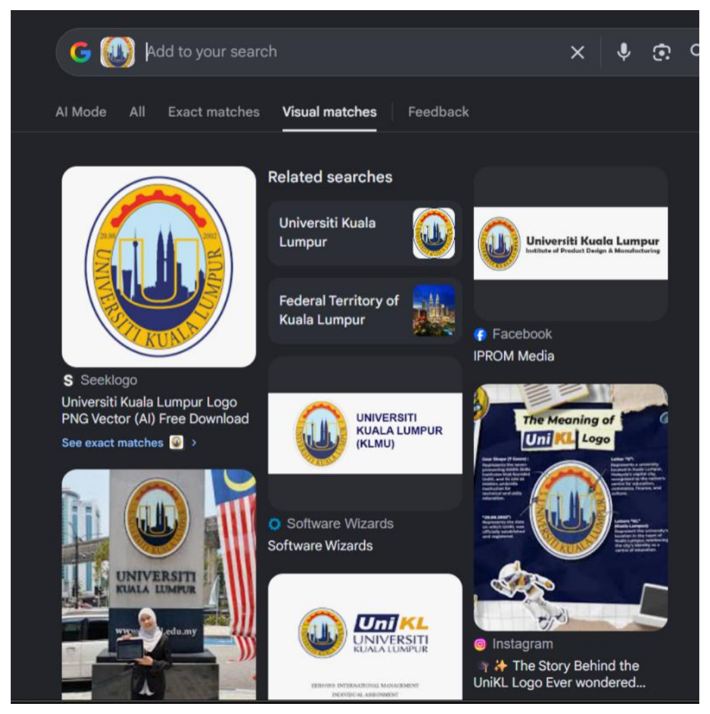

---

## Finding 8: Email

| Field | Entry |
|---|---|
| Identity | Alimie Mustaqim bin Mazudi — 52215226059 |
| Source / target | unikl.edu.my or controlled training sample |
| Tool / method | Gmail "Show Original" (Email Header / Message Route Analysis) |
| Exact query | Show original on an email received from UniKL (headers only) |
| Capture timestamp | 8 Nov 2026, 16:53 MYT |
| Observation | Email originated from unikl.edu.my. SPF: PASS with IP `2a01:111:f403:c405::7` (Microsoft-owned range). DKIM: PASS with domain unikl.edu.my. DMARC: PASS. Routed through Microsoft 365 / Outlook infrastructure. |
| Interpretation | Confirms UniKL uses Microsoft 365 for email, with full anti-spoofing protection (SPF + DKIM + DMARC all PASS). Headers trace the mail relay path, not the sender's physical device. |
| Corroboration | The Microsoft sending IP matches the MX record `unikl-edumy.mail.protection.outlook.com` (Findings 2 & 3 of the main report); SPF/DMARC presence matches Wappalyzer (Finding 4 above). |
| Confidence + rationale | Confirmed (three independent sources agree) |
| Limitation | Only one email examined; headers can be partially spoofed; relay IP is not the sender's real location. Recipient email address redacted for privacy. |

**Supporting evidence:**

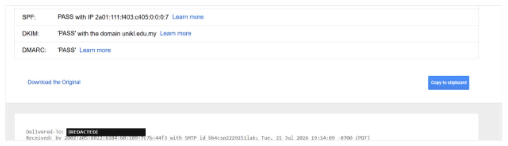

```
SPF:   PASS with IP 2a01:111:f403:c405:0:0:0:7
DKIM:  'PASS' with the domain unikl.edu.my
DMARC: 'PASS'

Delivered-To: [REDACTED]
Received: by 2002:a05:6022:b184:b0:109:7c7b:44f3 with SMTP id bb4csp2229251lab;
          Tue, 21 Jul 2026 19:14:09 -0700 (PDT)
```

---

## Username / Identity Enumeration

| Field | Entry |
|---|---|
| Identity | Alimie Mustaqim bin Mazudi — 52215226059 |
| Source / target | unikl.edu.my or controlled training sample |
| Tool / method | WhatsMyName Web (whatsmyname.app) — username enumeration |
| Exact query | Test handle "unikltest", filter: All (exclude NSFW) |
| Capture timestamp | 8 Nov 2026, 17:00 MYT |
| Observation | 653 sites processed; 2 "found" — both Internet Archive (`archive.org/search.php?query=unikltest`), category misc. |
| Interpretation | The two "found" results are archive.org search URLs, which return a page for any query. These are false positives — **NOT** proof that the handle exists or is owned by anyone. A "found" URL is never proof of account ownership. |
| Corroboration | No second source — not independently verified. |
| Confidence + rationale | Unknown (false positives; no evidence of ownership) |
| Limitation | Tool sends requests (not passive); high false-positive rate; a test handle was used, not a real UniKL-linked identity. |

**Supporting evidence:**

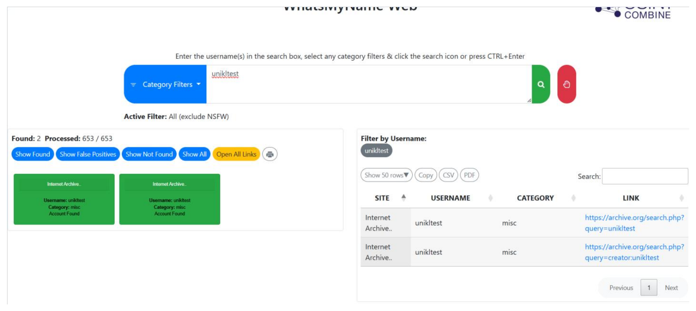

---

## Summary of Strongest Findings

1. **Triangulated hosting & email identity** — Netcraft, Shodan and WHOIS all point to the same hosting organization label, while the MX record, the SPF sending IP and the email header (Finding 8) independently confirm Microsoft 365 email (Findings 2–4, 8).
2. **Mixed cloud infrastructure** — UniKL's subdomains span local hosting, Microsoft Azure and AWS (Finding 2), while email is outsourced to Microsoft 365 (Findings 4, 8).
3. **Long-standing, stable domain** — registered since 2003, archived 5,703 times, consistent across WHOIS and Wayback Machine (Findings 1, 7).
4. **Publicly indexed administrative documents** — Google indexes internal guide/fee documents dating back years, still accessible today (Finding 5).
5. **OSINT literacy points** — file extensions are not reliable indicators of file type (Finding 6); a tool "found" result is a false positive, not proof of account ownership (Username/Identity Enumeration); and a widely reused logo does not establish origin (Reverse Image Search).

## Limitations of This Investigation

- All data reflects passive, point-in-time observations; infrastructure may have changed since capture.
- Single-resolver DNS queries are not authoritative confirmations.
- Beyond the cross-referencing noted within each finding, no deeper independent validation was performed.
- Username enumeration sends HTTP requests and is therefore not strictly passive; it was carried out with a test handle only, never against a real UniKL-linked identity.

---

*This document is a source-based OSINT learning investigation. No scanning, brute-forcing, exploitation, or credential testing was performed against UniKL infrastructure.*
